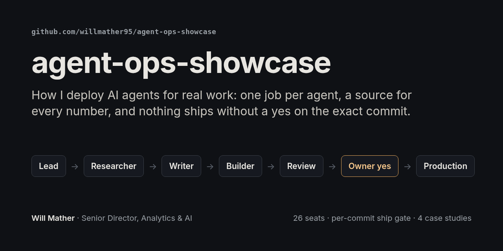
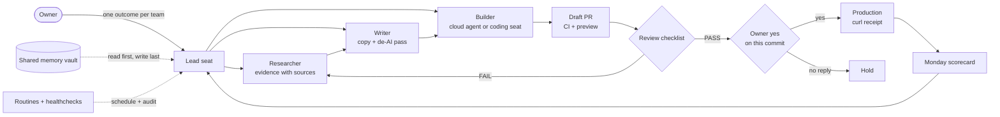

# agent-ops-showcase

How I deploy and run AI agents for real work: who does what, how work moves between agents, what stops a bad change from reaching production, and how I measure whether any of it pays off.

Prompts, logs, customer data and business numbers stay private. Everything here is a sanitized copy of a real file or a description of something that ran, with its date. [NOTES.md](NOTES.md) lists the source for each claim.

## How I deploy agents in an org

**Adoption.** At my day job I drove company-wide AI adoption to 95%+, with about 90% active weekly, and trained 200+ employees and clients. Training aimed at judgment, not usage counts: when AI is the right tool, and whether a workflow pays for itself in business value, token cost, team capacity and the human review it still needs. Before any build, I interview senior leaders, score AI maturity by function, and turn the gaps into a ranked list of agents and workflows.

**Review gates.** Agents propose, people approve. In my own fleet a standing "you may ship" grant lasted one day (2026-10-06 to 10-07). Since then, every merge or deploy needs a yes on that pull request at that commit, after a fixed checklist runs against the preview. When an older automation slipped past the gate, the fix was a gate it couldn't skip: draft PRs only, CI on every PR, and a build that fails on unreviewed copy ([case study 2](case-studies/02-the-bot-that-skipped-review.md)).

**Measuring usage.** A weekly scorecard counts tasks finished with a production receipt, errors caught in review vs. errors that reached production, and usage-limit hits from every routine's run history. Hours saved only appear when a baseline exists; otherwise the line says "not measured yet". Paid tools run under a dollar cap set in code (for example $10 a month and $3 a run per site for SEO data) with a cost log. When routines hit the usage limit on four days in under four weeks, I cut the fleet to fewer seats instead of buying more ([case study 3](case-studies/03-seat-consolidation.md)).

**Account health.** One owner per job, a written "not allowed" list per agent, and a report that leads to a decision. At the agency, that approach grew one enterprise account from a single analytics supervisor to a multi-level delivery team. It also turned a 174-row weekly report into decision briefs for each stakeholder, and earned a 25% scope expansion at renewal.

## Read next

| | |
|---|---|
| [Architecture](docs/architecture.md) | Roles, handoff files, the ship gate, review loops, routines and memory |
| [HSA Trackr weekly SEO loop](case-studies/01-hsa-trackr-weekly-loop.md) | A programmatic SEO site run by a four-role agent team, one verified change a week |
| [The bot that skipped review](case-studies/02-the-bot-that-skipped-review.md) | An older automation pushed an unsourced FAQ to production. Cause, catch and a free fix |
| [Cutting the fleet down](case-studies/03-seat-consolidation.md) | From about 19 seats around one person to two teams with 5 active seats, nothing deleted |
| [The nightly data load that went quiet](case-studies/04-nightly-data-load.md) | A silent failure in the analytics loader and the rules it produced |
| [Templates](templates/) | Blank BRIEF, STATE, LOG, MISTAKES, failure checklist and cloud-agent prompt |

## The fleet

- 26 Grok Bot seats, each with one job and its own routines.
- Cursor cloud agents build most pull requests from a prompt file that names the files they may touch.
- Claude Code or Codex on a dedicated machine for long jobs.
- One shared Git memory vault.
- Two healthcheck routines audit the other routines and the transcripts.

## Run the pieces yourself

| Repo | What it is |
|---|---|
| [seo-pack](https://github.com/willmather95/seo-pack) | The SEO and AI-answer skills the weekly loop runs on |
| [agent-ops-skills](https://github.com/willmather95/agent-ops-skills) | Fleet upkeep: routine and transcript healthchecks, overnight watch, coding-seat handoff, page and video QA |
| [vault-memory](https://github.com/willmather95/vault-memory) | Shared Git-backed memory for every bot |
| [human-copy](https://github.com/willmather95/human-copy) | The de-AI pass every public sentence goes through |
| [world-class-charts](https://github.com/willmather95/world-class-charts) | React chart and KPI components, plus an agent skill that builds dashboards with them |
| [agent-rules-restructure](https://github.com/willmather95/agent-rules-restructure) | Shrinks sprawling CLAUDE.md / AGENTS.md files into one shared root |
| [emdash-hsa-limits](https://github.com/mavericksolutions7/emdash-hsa-limits) | Sourced IRS HSA limits as a CMS plugin, from the HSA Trackr build |

## Five rules I'd bring to any team

1. **One job per agent, with a written "not allowed" list.** Most failures I've seen came from an agent doing a reasonable thing that was someone else's job.
2. **Evidence is a file, not a claim.** No URL and check date, no number on the page.
3. **Gate the change, not the agent.** A yes covers one pull request at one commit.
4. **Put checks in code.** The worst incident here passed because tests existed and nothing ran them.
5. **Watch the watchers.** Routines drift, go quiet and burn usage. Audit them weekly.

[Will Mather on LinkedIn](https://www.linkedin.com/in/willmather)
