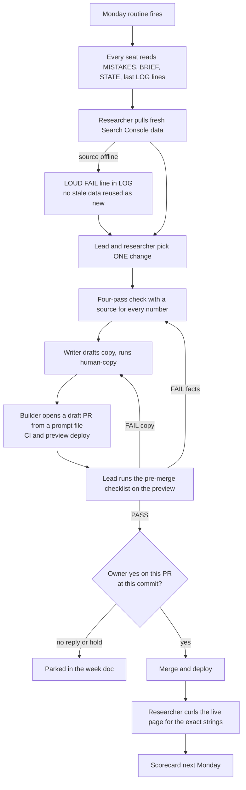

# Architecture

## Seats

A seat is one bot with one job, its own instructions and its own scheduled routines. There are 26 seats on disk. After the October 2026 consolidation (see [case study 3](../case-studies/03-seat-consolidation.md)), the money work runs through two small teams that share a lead and a writer.

| Role | What it does | What it may not do |
|---|---|---|
| **Lead** | Picks the week's one change, hands out work, runs the review gate, brings me the PR and the review result | Merge without a PASS review and my yes; ship a second change in a week; delete or archive a seat |
| **Researcher / operator** (one per property) | Pulls Search Console, analytics and live-page evidence; proves a change went live | Deploy; invent a fee, volume or metric; grow programmatic pages; call a stale export fresh |
| **Writer** | Turns evidence into page copy, then runs the [human-copy](https://github.com/willmather95/human-copy) pass | Add facts that are not in the evidence; post anything |
| **Builder** | A Cursor cloud agent launched by the lead, or a coding seat running Claude Code / Codex for big jobs. Opens one small PR from a prompt file | Merge its own PR; touch files outside the prompt's scope |
| **Reviewer** | A step the lead runs, not a seat. Checks the preview deploy against a fixed checklist | Edit the PR during review. It sends it back instead |

Other seats sit outside the teams: an advice-only council of three consultant personas that I ask together in one thread, a bot that designs new bots, a changelog scout, and craft seats for design, motion and video. Seats that were merged into others are parked with a one-line note, not deleted, so any one can be woken with one message.

## Handoff files

Every team keeps the same small set of files. Every seat reads them at the start of every run. Blank versions are in [templates/](../templates/).

| File | Holds | Written by |
|---|---|---|
| `BRIEF.md` | The property, the conversion that counts, publish gates, brand rules | Me and the lead, rarely changed |
| `STATE.json` | Current numbers with their source path and date, open defects, this week's change | Researcher |
| `LOG.md` | One dated line per action: reads, picks, REVIEW lines, my yes, merge SHAs, live receipts, `FAIL:` lines | Every seat, append only |
| `MISTAKES.md` | Lessons that became rules. Two review FAILs on the same item in a month become a new line | Lead |
| `FAILURE-CHECKLIST.md` | Top failures per seat and the pre-merge checklist | Lead |
| `cloudagent-prompt-*.md` | The builder's brief: goal, files it may edit, files it must not touch, tests, "draft PR only" | Researcher or lead |

The prompt file is the contract with the builder. It names the exact files the PR may touch and lists files that belong to other open PRs, so parallel agents do not collide.

## The weekly loop

**Definition of done:** the change is live, a curl of the production page shows the exact strings, the REVIEW line says PASS, and my yes is in the LOG with a timestamp. A merged PR with no live receipt is not done.

## The ship gate

- On 2026-10-06 I gave the lead a standing yes to merge and deploy SEO changes on my own sites. Three PRs shipped under it.
- On 2026-10-07 I took it back. Since then every merge or deploy needs my yes on that PR at that head commit.
- A new commit after the yes needs a new yes, and no reply means hold.
- The things that always need my yes: any merge or deploy, new programmatic pages, partner links on money pages, pricing changes, any email to a partner, and domain purchases.

## Review loops

1. **Pre-merge checklist.** Run against the preview URL, not the writer's intent. It checks that every claim maps to a source, prices are dated, links resolve, brand spelling and title/meta are right, copy is free of AI tells, the change works on mobile, and the call to action works. The result is one `REVIEW PR#<n> PASS|FAIL items: ...` line.
2. **Live verify.** After deploy, the researcher curls production and logs the strings it found.
3. **Mistakes file.** A repeat failure becomes a rule that every seat reads first.
4. **Scorecard.** Every Monday: tasks finished with a live receipt, errors caught in review, errors that reached production, usage-limit hits, and one seat to fix per team.

## Routines

| Routine | Cadence | What it does |
|---|---|---|
| Weekly SEO loop | Monday morning, per property | Runs the loop above |
| Daily check | Weekday mornings | Watches only. Never starts a second change |
| Routine healthcheck | Monday | Audits every bot's routines for waste, then sends the scorecard ([skill](https://github.com/willmather95/agent-ops-skills/tree/main/skills/routine-healthcheck)) |
| Transcript healthcheck | Weekday mornings | Mines transcripts for repeated corrections; silent when clean ([skill](https://github.com/willmather95/agent-ops-skills/tree/main/skills/transcript-healthcheck)) |
| Nightly data load | Monday and Thursday overnight | Loads Search Console data for four properties into a local DuckDB file, then checks freshness ([case study 4](../case-studies/04-nightly-data-load.md)) |
| Overnight watch | Per long job | A morning check-in that resumes or reports a cut-off run ([skill](https://github.com/willmather95/agent-ops-skills/tree/main/skills/overnight-watch)) |

## Memory

All bots share one private Git repo of Markdown notes. Each bot reads the index and the few notes a task needs, then writes one short note to `inbox/` when it finishes. Commits name files by explicit path, never `git add -A`. The skill is public as [vault-memory](https://github.com/willmather95/vault-memory).

## Tooling around the fleet

- **Search data:** Search Console through a service account, plus a self-hosted [OpenSEO](https://github.com/every-app/open-seo) MCP server for keyword, SERP and backlink data, behind an access gate, with a dollar cap per site.
- **Product analytics:** PostHog, read by the bots through its MCP connector.
- **Builds:** Cursor cloud agents for most PRs; Claude Code or Codex on a dedicated machine for long jobs.
- **Writing:** every public sentence goes through human-copy.
